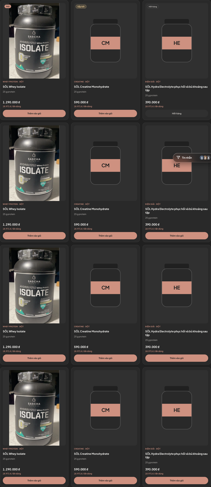
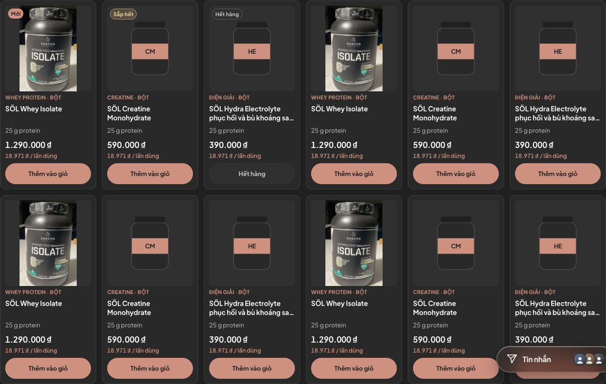
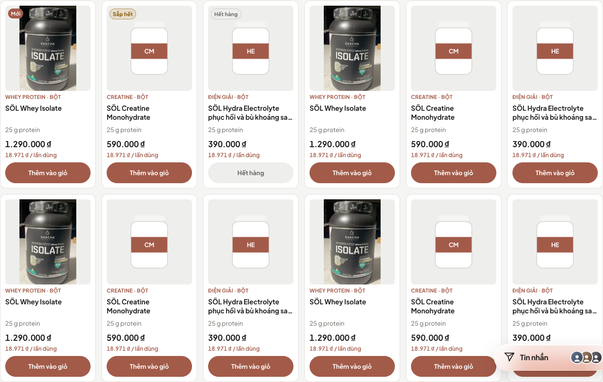
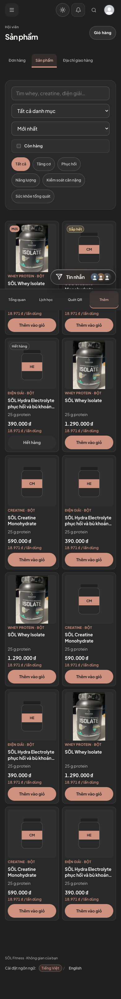

# Thu gọn sản phẩm trong portal — 06/11/2026

Theo yêu cầu người dùng, giảm kích thước thẻ sản phẩm ở `/member/orders?tab=shop`, giữ theme charcoal–salmon và chức năng mua hàng.

## Mẫu tham khảo

- [Lazada — danh mục Protein](https://www.lazada.vn/tag/protein/): đã mở bằng Chrome ở viewport 1440×1000; các ảnh sản phẩm hiển thị vuông 200×200px và một số ảnh 233×233px. Bố cục lưới dày, tên khoảng hai dòng, giá dễ quét. Đây là số đo của lần truy cập này, không phải một chuẩn kích thước cố định của sàn.
- Đã tra thêm [Shopee](https://shopee.vn/list/whey) và [Tiki](https://tiki.vn/protein/c67771). Shopee chuyển về trang chung; danh mục Tiki không tải ảnh sản phẩm trong phiên kiểm tra. Không suy đoán số đo cho hai sàn này.

Áp dụng cho SÖL: lưới tự lấp cột, khung ảnh vuông `object-fit: contain`, thẻ giữ kích thước gọn kể cả khi danh mục ít sản phẩm, tên tối đa hai dòng; giữ thông tin tồn kho, giá/lần dùng và nút mua ≥44px. CSS chỉ đổi trong portal, khung ảnh chi tiết/mua nhanh giữ tỷ lệ riêng.

## Số đo Chrome trước / sau

Dữ liệu API fixture 12 sản phẩm gồm tên dài, ảnh thật/ảnh dự phòng, mới/sắp hết/hết hàng; không ghi dữ liệu thật. Cả Light và Dark cho cùng số đo, nút mua cao 44px và không có tràn ngang.

| Viewport | Cột trước → sau | Thẻ trước → sau (rộng × cao, px) | Ảnh sau (px) |
| --- | --- | --- | --- |
| 320 | 1 → 2 | 288×549 → 139×333 | 121×121 |
| 390 | 1 → 2 | 358×633 → 174×368 | 156×156 |
| 768 | 2 → 3 | 298×561 → 196×391 | 174×174 |
| 1024 | 2 → 4 | 426×714 → 208×403 | 186×186 |
| 1440 | 3 → 6 | 413×721 → 202×397 | 180×180 |
| 1920 | 3 → 8 | 573×891 → 209×403 | 187×187 |
| 2560 | 3 → 11 | 787×1147 → 207×402 | 185×185 |

Số đo đầy đủ: [trước](before.json), [sau](after.json). Chiều cao có thể thay đổi theo nội dung thực tế; không khóa cứng chiều cao thẻ.

## Kiểm chứng

- 17 file / 69 test shop đạt; build và lint frontend đạt; `git diff --check` đạt.
- Kiểm tra trình duyệt ở 320/390/768/1024/1440/1920/2560px, cả Light/Dark: khung ảnh vuông, kích thước thẻ gọn, không tràn ngang, chữ nút không tràn và vùng bấm cao tối thiểu 44px.
- `scripts/verify-shop-ui.cjs`: toàn bộ kiểm tra đạt, gồm landing/catalog, bộ lọc, chọn biến thể/giỏ hàng, redirect đăng nhập, checkout fixture, lịch sử đơn, thao tác xử lý đơn của lễ tân và màn quản lý sản phẩm. Unit test shop xác minh thêm mở mua nhanh/thêm giỏ trong portal. Không kết nối thanh toán hay tạo đơn hàng thật.

## Ảnh

Trước, desktop 1440px:

Sau, desktop 1440px:

Sau, mobile 390px:

