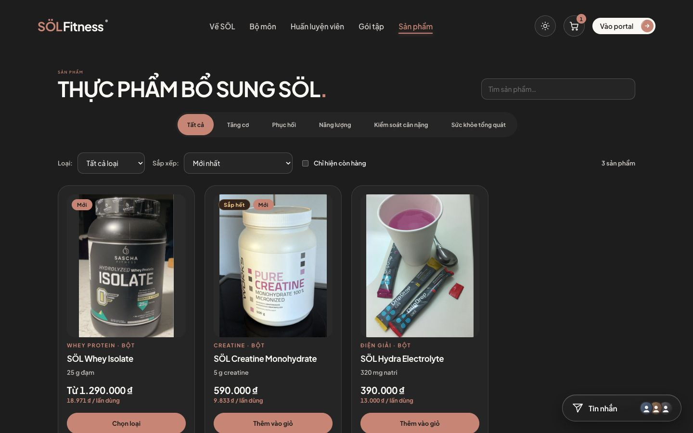
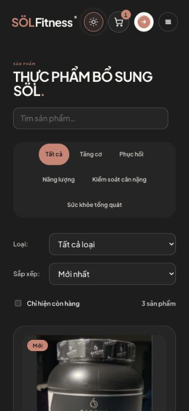
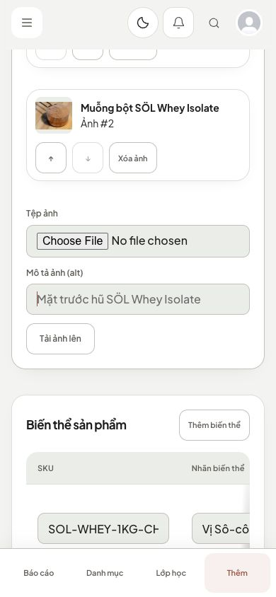
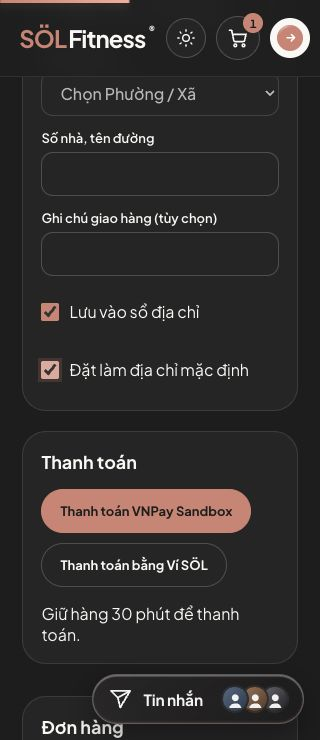

# Audit khoảng cách thao tác cửa hàng — 06/11/2026

Kiểm tra bổ sung theo yêu cầu người dùng: khoảng cách nút, vùng bấm và bố cục bán hàng. Giữ theme, font và tổ chức màn hình hiện tại.

## Lỗi và điều chỉnh

| Vị trí | Trước khi sửa | Sau khi sửa |
| --- | --- | --- |
| Lọc mục tiêu công khai | Gap 4px; nút desktop cao 40px | Gap 8px, cao tối thiểu 44px |
| Tab shop hội viên/quản lý/lễ tân | Gap 4px | Gap 8px, cao tối thiểu 44px, xuống dòng khi thiếu chỗ |
| Checkout: lưu địa chỉ/mặc định | Label chỉ cao 21px | Cả label bấm được, cao tối thiểu 44px |
| Checkbox quản trị/sổ địa chỉ | Label nhỏ; checkbox trong bảng chỉ 13×13px | Label tối thiểu 44px; checkbox trong bảng có vùng bấm 44×44px |
| Chuyển ảnh sản phẩm | Nút mũi tên rộng khoảng 33,5px | Tối thiểu 44×44px, cách nhau 8px |
| Mô tả ảnh dài | Hàng flex chưa giới hạn co/ngắt chuỗi | Ảnh giữ kích thước, mô tả được co và ngắt chuỗi dài |
| Bảng sửa biến thể/dinh dưỡng | Ở 390px, ô SKU chỉ rộng khoảng 35,9px; nút Xóa dinh dưỡng bị xuống dòng | Bảng cuộn riêng 1120/880px; ô SKU đo được 185,6px; nút thao tác tối thiểu 44×44px và không xuống dòng |

Các nút mua hàng, lựa chọn biến thể, số lượng và giỏ hàng đã có kích thước/khoảng cách phù hợp nên giữ nguyên. Không thay đổi logic đặt hàng, giá, tồn kho, thanh toán hay API.

## Kiểm chứng

- Trình duyệt local qua CUA, API fixture từ dữ liệu kiểm thử có sẵn của repo; không dùng tài khoản thật, không ghi đơn hàng/thanh toán thật.
- Đã xem catalog, chi tiết, giỏ hàng, checkout, shop hội viên/mua nhanh và quản lý sản phẩm/trình sửa. Phần tab lễ tân và checkbox hộp thoại dùng chung được rà soát source; chưa chạy quy trình xử lý đơn thực tế.
- Đo tại viewport 320px, 390px và 1440px. Catalog, checkout và trình sửa được kiểm tra ở màn hình hẹp; trang không tràn ngang. Bảng trình sửa cuộn bên trong wrapper.
- Đã xem Light và Dark. Nút chuyển ảnh đo 44×44px; checkbox checkout cao 44px ở cả 320 và 1440px. Thao tác checkbox mặc định hoạt động qua UI.
- `npm run test -- src/features/shop`: 17 file, 69 test pass.
- `npm run lint`, `npm run build`, `git diff --check`: pass.

Đây là audit UI bằng fixture; không thay thế kiểm thử tích hợp backend hay thanh toán thật. Chưa deploy lên VPS.

## Ảnh sau sửa

